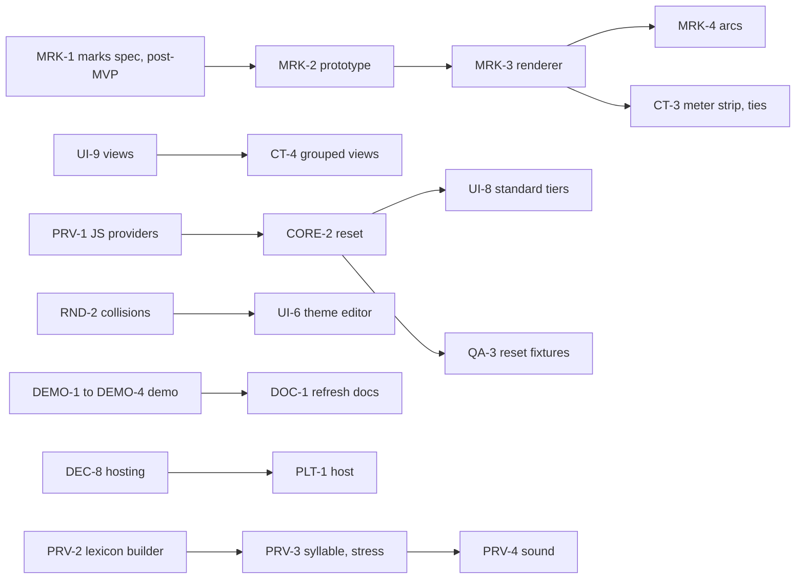

# Roadmap

> The board for poetic-overtones: where the project stands, every queued task grouped into epics, and what
> blocks what. Start here in a new session, then read the latest note in `docs/reviews/`.
> Last updated 2026-10-28. History: `docs/HISTORY.md`.

## Where we are

The **text form** (`.pxml`) is specified with 53 fixtures. The **rendering model** is decided: themes are
plain CSS over a mirror of the analysis, tiers are layers, and text styles and box styles are painted
as ordinary CSS that prints. A dependency-free **core library** loads, edits (with undo) and saves
documents. A small **app** opens, renders, edits and saves them. The **community theme** is encoded.
Alex settled the open decisions on 2026-10-24 (`docs/reviews/2026-10-24.md`): the MVP has **no marks**
(ADR-0017). What remains for an MVP is UI work and a check of the community theme's colours with its author.

Run it: `npm test` (all checks), `npm run serve` then <http://localhost:8000/app/>.

## Now / Next at a glance

| | Task | Why now |
|---|---|---|
| 🟡 Next | **DEMO-3, DEMO-4** Check the scansion; look at the recording | Needed before the share |
| 🟡 Next | **UI-7** the rest: PNG, legend, real PDF | Print through the browser works |
| 🟡 Next | **CT-6** Confirm the seven colours and bold-italic stress with the author | The only thing the community theme still waits for (Alex asks) |
| ⚪ Later | **DOC-1** Refresh README, HISTORY and the project records | After the next build work |
| ✅ Done | **2026-10-28:** MIT licence, README refreshed, `demo-mvp` merged into `main`, author email changed to the GitHub noreply address | the 2026-10-28 entry in `docs/projects/0003-demo-mvp/LOG.md` |
| ✅ Done | **2026-10-25:** demo MVP: UI-4, UI-5, RND-1, CORE-1, CORE-5, CT-5, QA-1, DEMO-1, DEMO-2, most of UI-7 | `docs/projects/0003-demo-mvp/` |
| ✅ Done | **2026-10-24:** decisions DEC-1 to DEC-7 and DEC-11, all provisional rules adopted, credit added | `docs/reviews/2026-10-24.md`, ADR-0014 to ADR-0017 |
| ✅ Done | **PRV-1, CORE-2, UI-8** Lexicon-free providers, reset, standard tiers in the app | Done 2026-10-19 |

## Board

Status: ✅ done · 🟢 doing · 🟡 ready · ⛔ blocked (by the tasks named) · ⚪ later.
Task IDs are stable; add new ones at the end of an epic.

### DEC: decisions only Alex can make

| ID | Task | Status | Blocks | Notes |
|---|---|---|---|---|
| DEC-1 | Credit wording: "Eric Kingsepp (Éadric Scúsmiþ)". Confirming the 7 settled colours and bold-italic secondary stress with the author is CT-6 | ✅ | | ADR-0014, 2026-10-24 |
| DEC-2 | Sound tag names: keep ARPAbet-like, for now | ✅ | | Q16, 2026-10-24; revisit if Shavian needs its own names |
| DEC-3 | Ids: soften S-04 to "unique in the document" | ✅ | | ADR-0015, Q17, 2026-10-24 |
| DEC-4 | Scope of marks for the MVP: none (option A) | ✅ | | ADR-0017, Q18, 2026-10-24 |
| DEC-5 | Export of `<style src>`: inline | ✅ | | Q19, 2026-10-24 |
| DEC-6 | The PROVISIONAL rules: all adopted | ✅ | | `docs/reviews/2026-10-24.md` part 3 |
| DEC-7 | Browser tests may use Playwright as a dev-only dependency | ✅ | | ADR-0016, 2026-10-24 |
| DEC-8 | Hosting and the stack beyond the POC (the name is decided: poetic-overtones, ADR-0013) | ⚪ | PLT-1 | `docs/synthesis/stack-and-name-options.md` |
| DEC-9 | FQ8 (provider id form), FQ9 (shared indent), C-08 | ⚪ | | not blocking the MVP |
| DEC-10 | Timestamp for the Tengwar-mode remark in the README | ⚪ | | README TODO |
| DEC-11 | Busy display of unconfirmed members: themes style `member[inferred]` more quietly | ✅ | | 2026-10-24; Reader theme done (UI-10) |

### CORE: model, loader, editing (`src/core/`)

| ID | Task | Status | Blocked by | Notes |
|---|---|---|---|---|
| CORE-0 | Loader, model, canonical export, editing with undo | ✅ | | ADR-0012; 53 fixtures, 23 round trips, 26 editor checks |
| CORE-1 | Multi-piece marking: one span from several selections (M-05) | ✅ | | "Add as piece" (P) then Mark; W-06; `tests/browser.mjs` |
| CORE-2 | Reset (E-03) and span reuse for provider tiers (E-08) | ✅ | | `Editor.addStandardTier`, `reset`, `unlink`; E-10; `tests/reset.mjs` |
| CORE-3 | Ids across sessions | ✅ | | closed by ADR-0015: S-04 softened, no code change |
| CORE-4 | Keep `src` on export, if chosen | ✅ | | not chosen (Q19): export stays inline |
| CORE-5 | Working copy kept in the browser between visits (O-04) | ✅ | | local storage, one slot (ADR-0018, O-05); IndexedDB later |
| CORE-6 | Faster undo and repaint for long texts (W-04) | ⚪ | | snapshots and full repaint are fine for poems |

### RND: rendering (`src/render/`)

| ID | Task | Status | Blocked by | Notes |
|---|---|---|---|---|
| RND-0 | Mirror, text and box painters, print-safe | ✅ | | ADR-0011; checked in Chromium, Safari, Firefox and PDF |
| RND-1 | Click a painted member to select it in the panel | ✅ | | `view.at(offset)`; W-05 |
| RND-2 | Collision and contrast warnings (Y-05, Y-06) | 🟡 | | needed by UI-6 |
| RND-3 | Accessible painted text (Q20) | 🟡 | | added characters are hidden from screen readers today |

### MRK: marks (text above or below, line strips, arcs). Post-MVP (ADR-0017)

| ID | Task | Status | Blocked by | Notes |
|---|---|---|---|---|
| MRK-1 | Spec: how a theme asks for a mark, and how marks layer | ⚪ | | `spec/app.md` Y-03 "Box (later)", Q18; start after the MVP |
| MRK-2 | Prototype marks in `prototypes/` and check print | ⚪ | MRK-1 | |
| MRK-3 | Marks in `src/render/` | ⚪ | MRK-2 | |
| MRK-4 | Relation arcs (R-05) | ⚪ | MRK-3 | |

### UI: the app (`app/`, `docs/ui-plan.md`)

| ID | Task | Status | Blocked by | Notes |
|---|---|---|---|---|
| UI-1 | Shell: open, render, layers, themes, undo, save | ✅ | | |
| UI-2 | Marking selected text into a set | ✅ | | key M |
| UI-3 | Tier and set details; confirm inferred members | ✅ | | |
| UI-4 | Selection helpers: snap to words or graphemes, several pieces, keyboard | ✅ | | snap to words, pieces, M and P keys (W-06). Not done: snap to graphemes, selecting by keyboard alone |
| UI-5 | Relations: build by selecting spans in turn; reorder directed members | ✅ | | marking into a relation set builds it; ← → reorder a directed one; arcs are post-MVP |
| UI-6 | Theme editor (Y-07): controls that write CSS for a role, set or tag | ⛔ | RND-2 | |
| UI-7 | Files: drag and drop, working copy (CORE-5), print view and PDF export (A-02) | 🟡 | | done: drag and drop, working copy, print view with theme credit, PDF through the print dialog (A-06). Not done: PNG, the legend (A-03), a real PDF export |
| UI-8 | Standard tiers from providers, with reset | ✅ | | lines, stanzas, words; Reset and Unlink in tier details |
| UI-9 | Views: filter by tag, place, manner (the deck's grouped views) | 🟡 | | T-06 |
| UI-10 | Reader theme: style `member[inferred]` quietly (DEC-11) | ✅ | | dotted underline in `app/sample.js`; checked by `npm test` only, not yet by eye in a browser |

### CT: community theme (`themes/`)

| ID | Task | Status | Blocked by | Notes |
|---|---|---|---|---|
| CT-0 | Encode the deck: consonants, vowels, diphthongs, stress | ✅ | | `themes/community.css` |
| CT-1 | Add the credit | ✅ | | ADR-0014: `themes/community.css`, `themes/README.md`, README, AGENTS.md |
| CT-2 | Rename sound tags if chosen | ✅ | | not needed: DEC-2 keeps the names |
| CT-3 | Meter strip and ties | ⚪ | MRK-3 | post-MVP (ADR-0017); the deck never defines ties; ask the author |
| CT-4 | Grouped views by place, manner, sibilant | ⛔ | UI-9 | |
| CT-5 | A plain default theme besides the community theme | ✅ | | `themes/plain.css`; "Add theme" in the app (Y-13) |
| CT-6 | Confirm the seven settled colours (M11) and bold-italic secondary stress (M12) with the author, apply the answers, and agree the licence terms of the scheme's CSS | 🟡 | | Alex asks; `themes/README.md` has the colour table; the README says the licence is not yet agreed |

### PRV: providers (`spec/providers/`)

| ID | Task | Status | Blocked by | Notes |
|---|---|---|---|---|
| PRV-0 | Contract, English spec, Python reference and runner | ✅ | | ADR-0010 |
| PRV-1 | `text.line`, `text.stanza`, `english.word` in JS, run against the provider fixtures | ✅ | | `src/providers/`, `tests/providers.mjs` |
| PRV-2 | Lexicon builder from ReadLex (syllabify the IPA) | ⚪ | | post-MVP; letter alignment unsolved |
| PRV-3 | `english.syllable`, `english.stress` in JS | ⚪ | PRV-2 | |
| PRV-4 | `english.sound` tier | ⚪ | PRV-2 | needs a grapheme-aligned lexicon |

### QA: quality

| ID | Task | Status | Blocked by | Notes |
|---|---|---|---|---|
| QA-0 | Fixtures, round trips, editor tests in `npm test` | ✅ | | |
| QA-1 | Browser tests for the painter and the app in `npm test` | ✅ | | `npm run test:browser` (16 checks), separate from `npm test` (ADR-0016 addendum). The painter has no pixel checks yet |
| QA-2 | Retire `prototypes/layers/` and `scansion.html` once the app covers them | ⚪ | UI-4, MRK-3 | |
| QA-3 | Reset-by-hand fixtures (E-03, E-08) | 🟡 | | `tests/reset.mjs` covers the rules in code; file fixtures still to write |

### PLT: platform, Shavian and Tengwar

| ID | Task | Status | Blocked by | Notes |
|---|---|---|---|---|
| PLT-1 | Host the app | ⛔ | DEC-8 | it needs serving today (ADR-0012) |
| PLT-2 | Shavian text end to end: a Shavian sample, roles and themes over it | 🟡 | | the core already counts code points |
| PLT-3 | Tengwar view through shavian2tengwar | ⚪ | | `docs/synthesis/comparison.md` D1 to D6 |
| PLT-4 | Extensions (X rules) | ⚪ | | Q13 |

### DEMO: showing the project (a community Discord share; the next class is likely Tuesday 2026-10-27)

| ID | Task | Status | Blocked by | Notes |
|---|---|---|---|---|
| DEMO-1 | A fully marked public-domain poem: Sonnet 18 | ✅ | | `demo/build.mjs` makes `demo/sonnet18.pxml`; `tests/demo.mjs` |
| DEMO-2 | A script that records the walkthrough as MP4 and GIF | ✅ | | `npm run demo:record` writes `.tmp/demo/` (not committed); needs ffmpeg |
| DEMO-3 | Alex checks the scansion of Sonnet 18 before it is shown as analysis | 🟡 | | an agent marked it as an example; lines 1 to 4 and 13 and 14 |
| DEMO-4 | Look at the GIF and the app by eye; adjust pacing and scenes | 🟡 | | frames were checked from the video, not the finished GIF |

### DOC: documentation

| ID | Task | Status | Blocked by | Notes |
|---|---|---|---|---|
| DOC-1 | Refresh HISTORY, the ROADMAP summary and the project records after the next build work. Include a record for the 2026-10-19 work, which has no project folder. (README was refreshed on 2026-10-28.) | ⚪ | DEMO-4 | do it once those are done; AGENTS.md was refreshed on 2026-10-24 |
| DOC-2 | Write the next review note: carry forward what is still open (this note's part 4) and add new decisions | ⚪ | | do with DOC-1 |

## Dependencies

**Suggested order.** Before the share: DEMO-3 and DEMO-4 (Alex checks the scansion; look at the recording).
Then CT-6 (Alex asks the author), the rest of UI-7, and DOC-1. PRV-1, CORE-2 and UI-8 (standard tiers) are
done. An MVP is UI-1 to UI-8 and CT-1, with no marks (ADR-0017); with UI-4, UI-5 and CORE-5 done, what is
left is the polish in UI-7.

## ✅ Done

* **Foundation, 2026-10-14 and 15** (`docs/projects/0001-foundation/`): the text form and its fixtures,
  the rendering model, the core library and editing, the app shell, the community theme. Decisions in
  ADR-0009 to ADR-0012; review in `docs/reviews/2026-10-15.md`.
* **Decision round, 2026-10-24** (`docs/projects/0002-decision-round/`): DEC-1 to DEC-7 and DEC-11 settled, all
  provisional rules adopted, the author credited, the busy inferred style quietened. ADR-0014 to ADR-0017;
  `docs/reviews/2026-10-24.md`.
* **Scansion score:** `scansion.html`, the Shavian-only prototype that started the project.
