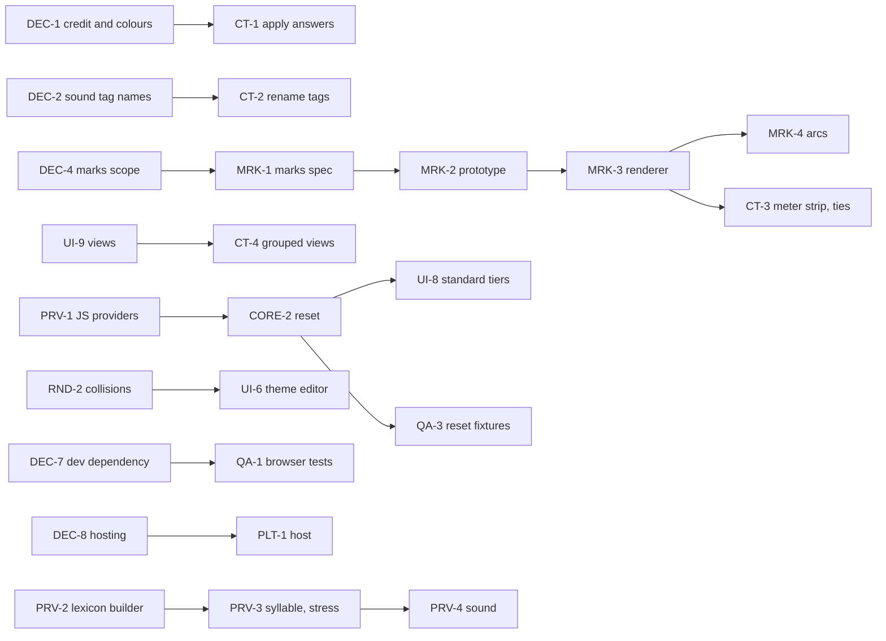

# Roadmap

> The board for poetic-overtones: where the project stands, every queued task grouped into epics, and what
> blocks what. Start here in a new session, then read the latest note in `docs/reviews/`.
> Last updated 2026-10-19. History: `docs/HISTORY.md`.

## Where we are

The **text form** (`.pxml`) is specified with 53 fixtures. The **rendering model** is decided: themes are
plain CSS over a mirror of the analysis, tiers are layers, and text styles and box styles are painted
as ordinary CSS that prints. A dependency-free **core library** loads, edits (with undo) and saves
documents. A small **app** opens, renders, edits and saves them. The **community theme** is encoded.
What remains for an MVP is mostly UI, a few decisions only Alex can make, and the design of **marks**
(text above or below a span, line strips, arcs).

Run it: `npm test` (all checks), `npm run serve` then <http://localhost:8000/app/>.

## Now / Next at a glance

| | Task | Why now |
|---|---|---|
| 🟢 Now | **DEC-1 to DEC-4**: Alex's decisions (credit, sound tags, ids, marks scope) | They unblock the community theme and the marks design |
| 🟡 Next | **MRK-1** Marks design (spec) | Unblocks the meter strip, ties and relation arcs |
| 🟡 Next | **UI-4** Selection helpers | Makes marking practical on real poems |
| 🟡 Next | **QA-1** Browser tests in `npm test` | The renderer and app are only checked by hand today |
| ✅ Done | **PRV-1, CORE-2, UI-8** Lexicon-free providers, reset, standard tiers in the app | Done 2026-10-19 |

## Board

Status: ✅ done · 🟢 doing · 🟡 ready · ⛔ blocked (by the tasks named) · ⚪ later.
Task IDs are stable; add new ones at the end of an epic.

### DEC: decisions only Alex can make

| ID | Task | Status | Blocks | Notes |
|---|---|---|---|---|
| DEC-1 | Credit wording for the community scheme; confirm the 7 settled colours and bold-italic secondary stress with its author | 🟡 | CT-1 | `themes/README.md`, ADR-0005, review A1 |
| DEC-2 | Sound tag names: ARPAbet-like (now), Shavian letter names, or other | 🟡 | CT-2 | `spec/app.md` Q16 |
| DEC-3 | Ids across sessions: soften S-04 or record retired ids | 🟡 | CORE-3 | Q17 |
| DEC-4 | Scope of marks for the MVP (meter strip? arcs? badges?) | 🟡 | MRK-1 | Q18 |
| DEC-5 | Export of `<style src>`: inline (now) or keep the reference | 🟡 | CORE-4 | Q19 |
| DEC-6 | Skim the PROVISIONAL rules (23 in format.md, 41 in app.md, 8 in contract.md) and adopt or change | 🟡 | | review A5 |
| DEC-7 | Browser tests may use Playwright as a dev-only dependency | 🟡 | QA-1 | ADR-0012 forbids runtime dependencies only |
| DEC-8 | Hosting and the stack beyond the POC (the name is decided: poetic-overtones, ADR-0013) | ⚪ | PLT-1 | `docs/synthesis/stack-and-name-options.md` |
| DEC-9 | FQ8 (provider id form), FQ9 (shared indent), C-08 | ⚪ | | not blocking the MVP |
| DEC-10 | Timestamp for the Tengwar-mode remark in the README | ⚪ | | README TODO |

### CORE: model, loader, editing (`src/core/`)

| ID | Task | Status | Blocked by | Notes |
|---|---|---|---|---|
| CORE-0 | Loader, model, canonical export, editing with undo | ✅ | | ADR-0012; 53 fixtures, 23 round trips, 26 editor checks |
| CORE-1 | Multi-piece marking: one span from several selections (M-05) | 🟡 | | `Editor.mark` already takes pieces; needs UI-4 |
| CORE-2 | Reset (E-03) and span reuse for provider tiers (E-08) | ✅ | | `Editor.addStandardTier`, `reset`, `unlink`; E-10; `tests/reset.mjs` |
| CORE-3 | Ids across sessions | ⛔ | DEC-3 | |
| CORE-4 | Keep `src` on export, if chosen | ⛔ | DEC-5 | |
| CORE-5 | Working copy kept in the browser between visits (O-04) | 🟡 | | needs a storage choice for the POC |
| CORE-6 | Faster undo and repaint for long texts (W-04) | ⚪ | | snapshots and full repaint are fine for poems |

### RND: rendering (`src/render/`)

| ID | Task | Status | Blocked by | Notes |
|---|---|---|---|---|
| RND-0 | Mirror, text and box painters, print-safe | ✅ | | ADR-0011; checked in Chromium, Safari, Firefox and PDF |
| RND-1 | Click a painted member to select it in the panel | 🟡 | | helps UI-4 and UI-5 |
| RND-2 | Collision and contrast warnings (Y-05, Y-06) | 🟡 | | needed by UI-6 |
| RND-3 | Accessible painted text (Q20) | 🟡 | | added characters are hidden from screen readers today |

### MRK: marks (text above or below, line strips, arcs)

| ID | Task | Status | Blocked by | Notes |
|---|---|---|---|---|
| MRK-1 | Spec: how a theme asks for a mark, and how marks layer | ⛔ | DEC-4 | `spec/app.md` Y-03 "Box (later)", Q18 |
| MRK-2 | Prototype marks in `prototypes/` and check print | ⛔ | MRK-1 | |
| MRK-3 | Marks in `src/render/` | ⛔ | MRK-2 | |
| MRK-4 | Relation arcs (R-05) | ⛔ | MRK-3 | |

### UI: the app (`app/`, `docs/ui-plan.md`)

| ID | Task | Status | Blocked by | Notes |
|---|---|---|---|---|
| UI-1 | Shell: open, render, layers, themes, undo, save | ✅ | | |
| UI-2 | Marking selected text into a set | ✅ | | key M |
| UI-3 | Tier and set details; confirm inferred members | ✅ | | |
| UI-4 | Selection helpers: snap to words or graphemes, several pieces, keyboard | 🟡 | | with CORE-1, RND-1 |
| UI-5 | Relations: build by selecting spans in turn; reorder directed members | 🟡 | | arcs wait for MRK-4; shared styles work now |
| UI-6 | Theme editor (Y-07): controls that write CSS for a role, set or tag | ⛔ | RND-2 | |
| UI-7 | Files: drag and drop, working copy (CORE-5), print view and PDF export (A-02) | 🟡 | | |
| UI-8 | Standard tiers from providers, with reset | ✅ | | lines, stanzas, words; Reset and Unlink in tier details |
| UI-9 | Views: filter by tag, place, manner (the deck's grouped views) | 🟡 | | T-06 |

### CT: community theme (`themes/`)

| ID | Task | Status | Blocked by | Notes |
|---|---|---|---|---|
| CT-0 | Encode the deck: consonants, vowels, diphthongs, stress | ✅ | | `themes/community.css` |
| CT-1 | Apply the author's answers; add the credit | ⛔ | DEC-1 | |
| CT-2 | Rename sound tags if chosen | ⛔ | DEC-2 | |
| CT-3 | Meter strip and ties | ⛔ | MRK-3 | the deck never defines ties; ask the author |
| CT-4 | Grouped views by place, manner, sibilant | ⛔ | UI-9 | |
| CT-5 | A plain default theme besides the community theme | 🟡 | | ADR-0005: one scheme among several |

### PRV: providers (`spec/providers/`)

| ID | Task | Status | Blocked by | Notes |
|---|---|---|---|---|
| PRV-0 | Contract, English spec, Python reference and runner | ✅ | | ADR-0010 |
| PRV-1 | `text.line`, `text.stanza`, `english.word` in JS, run against the provider fixtures | ✅ | | `src/providers/`, `tests/providers.mjs` |
| PRV-2 | Lexicon builder from ReadLex (syllabify the IPA) | ⚪ | | post-MVP; letter alignment unsolved |
| PRV-3 | `english.syllable`, `english.stress` in JS | ⚪ | PRV-2 | |
| PRV-4 | `english.sound` tier | ⚪ | PRV-2 | needs a grapheme-aligned lexicon |

### QA: quality

| ID | Task | Status | Blocked by | Notes |
|---|---|---|---|---|
| QA-0 | Fixtures, round trips, editor tests in `npm test` | ✅ | | |
| QA-1 | Browser tests for the painter and the app in `npm test` | ⛔ | DEC-7 | today they are ad hoc scripts |
| QA-2 | Retire `prototypes/layers/` and `scansion.html` once the app covers them | ⚪ | UI-4, MRK-3 | |
| QA-3 | Reset-by-hand fixtures (E-03, E-08) | 🟡 | | `tests/reset.mjs` covers the rules in code; file fixtures still to write |

### PLT: platform, Shavian and Tengwar

| ID | Task | Status | Blocked by | Notes |
|---|---|---|---|---|
| PLT-1 | Host the app | ⛔ | DEC-8 | it needs serving today (ADR-0012) |
| PLT-2 | Shavian text end to end: a Shavian sample, roles and themes over it | 🟡 | | the core already counts code points |
| PLT-3 | Tengwar view through shavian2tengwar | ⚪ | | `docs/synthesis/comparison.md` D1 to D6 |
| PLT-4 | Extensions (X rules) | ⚪ | | Q13 |

## Dependencies

**Suggested order.** The DEC items first (an hour of Alex's time unblocks the most). Then, in parallel:
MRK-1 (design), UI-4 with CORE-1 and RND-1 (marking on real poems), and QA-1 (browser tests).
PRV-1, CORE-2 and UI-8 (standard tiers) are done. An MVP is UI-1 to UI-8, CT-1, and MRK-3 if DEC-4 says the
meter strip is in.

## ✅ Done

* **Foundation, 2026-10-14 and 15** (`docs/projects/0001-foundation/`): the text form and its fixtures,
  the rendering model, the core library and editing, the app shell, the community theme. Decisions in
  ADR-0009 to ADR-0012; review in `docs/reviews/2026-10-15.md`.
* **Scansion score:** `scansion.html`, the Shavian-only prototype that started the project.
